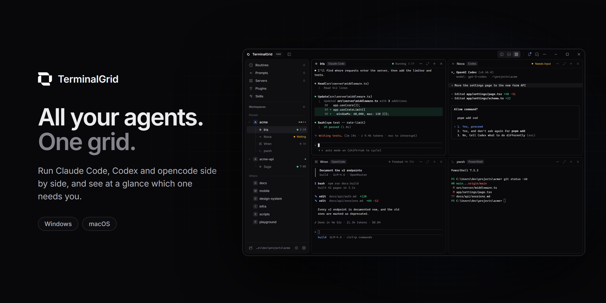

Download the latest version from [Releases](https://github.com/terminalgrid/releases/releases/latest). On Windows, use the setup `.exe` (or the portable `.zip`). On macOS, use the `.dmg`.

The app updates itself. You can also check manually under Settings > About.
